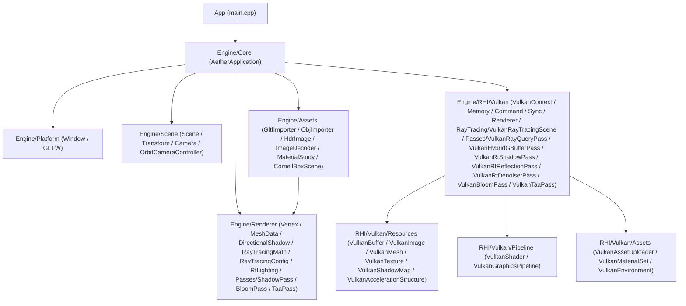

# Aether Engine — 渲染管线架构文档

本文档基于当前代码库（Vulkan 1.3 + C++20 + DXC HLSL）总结 Aether 实时渲染引擎的分层结构、资源所有权边界、帧渲染管线、IBL 预计算流程与测试体系。

---

## 1. 整体分层架构

Aether 采用严格单向依赖的分层设计，各层职责清晰分离：



| 模块路径 | 核心类 / 文件 | 职责说明 |
| --- | --- | --- |
| `App/` | `main.cpp` | CLI 入口，分发默认多实例场景、`--single-cube`、`--material-test [model]`、`--swapchain-test <scenario>`。 |
| `Engine/Core/` | `AetherApplication` | 应用生命周期与主循环编排：窗口/输入处理、拖放资产加载、场景对象解析为 `DrawItem`、交换链重建协调、按严格逆序关闭子系统。 |
| `Engine/Platform/` | `Window` | 封装 GLFW 窗口、事件轮询、滚轮偏移缓冲、Win32/GLFW 文件拖放路径收集与 Resize 标志。 |
| `Engine/Scene/` | `Scene`, `Transform`, `Camera`, `OrbitCameraController` | CPU 侧场景容器（按值存储 `SceneObject`）、TRS 矩阵、右手系 Vulkan `[0, 1]` 深度相机（Y 轴翻转投影）及轨道/平移/缩放控制器。 |
| `Engine/Assets/` | `GltfImporter`, `ObjImporter`, `HdrImage`, `ImageDecoder`, `MaterialStudy`, `CornellBoxScene` | 纯 CPU 资产解析：glTF/GLB 导入（`fastgltf`）、Wavefront OBJ 网格解析、Radiance RGBE `.hdr` 解码与经纬度→立方体面采样、WIC 图片解码（PNG/JPEG → RGBA8）、5×5 PBR 材质球阵列与默认 Cornell Box（22 网格 / 50 对象 + 物理灯光）生成。 |
| `Engine/Renderer/` | `Vertex`, `MeshData`, `DirectionalShadow`, `RayTracingMath`, `RayTracingConfig`, `RtLighting`, `Passes/ShadowPass`, `BloomPass`, `TaaPass` | 几何数据结构、方向光阴影空间数学、光追配置/光源/G-Buffer与降噪数学契约、以及光栅后处理 Pass 配置与调度数据。 |
| `Engine/RHI/Vulkan/` | `VulkanContext`, `VulkanRayTracingCapabilities`, `VulkanMemoryManager`, `VulkanCommandManager`, `VulkanSyncManager`, `VulkanRenderer` | Vulkan 1.3 核心上下文（含可选硬件光追能力探测、原子启用与 KHR 加速结构函数表）、VMA 内存分配、命令池/缓冲区、帧同步原语与光栅 / Hybrid RT / Ray Query 多模式渲染调度。 |

---

## 2. GPU 资源所有权与生命周期边界

Aether 对 GPU 资源遵循 **“共享访问不等于共享所有权”** 的硬性约束：

| 模块 | 持有对象 | 职责边界 |
| --- | --- | --- |
| `VulkanMemoryManager` | `VmaAllocator` | 仅负责 GPU 内存的分配、绑定、主机读写与释放；仅当设备启用 Buffer Device Address 时附加 `VMA_ALLOCATOR_CREATE_BUFFER_DEVICE_ADDRESS_BIT`；**不创建、不销毁、不持有**任何 `VkImage`、`VkBuffer` 或加速结构，也不感知业务语义。 |
| `VulkanImage` | `VkImage`, `VkImageView`, `VmaAllocation` | 自建图像由其创建并销毁 `VkImageView` 与 `VkImage`，再调用 `VulkanMemoryManager::Free()` 释放内存；交换链图像通过 `InitializeSwapchainView()` 仅持有视图，图像本体归 WSI 管理。 |
| `VulkanBuffer` | `VkBuffer`, `VmaAllocation`, `m_usage` | 持有缓冲区句柄、创建用途标志与对应 VMA 分配，通过 `VulkanMemoryManager` 完成绑定与 CPU/GPU 读写；仅对显式携带 `VK_BUFFER_USAGE_SHADER_DEVICE_ADDRESS_BIT` 且 BDA 已启用的缓冲区开放 `GetDeviceAddress()`。 |
| `VulkanMesh` | 顶点/索引 `VulkanBuffer`, `vertexCount`, `indexCount`, `uniqueId` | 由 `AetherApplication` 持有；`VulkanRenderer` 在 `DrawFrame()` 中仅借用只读指针；单调递增 `uniqueId` 作为 BLAS 缓存稳定身份标识；仅当显式开启 `enableRayTracingUsage` 时为顶点/索引缓冲追加 `SHADER_DEVICE_ADDRESS_BIT \| ACCELERATION_STRUCTURE_BUILD_INPUT_READ_ONLY_BIT_KHR`。 |
| `VulkanAccelerationStructure` | `VkAccelerationStructureKHR`, 底层存储 `VulkanBuffer`, `deviceAddress` | 专责单个 BLAS/TLAS 加速结构资源生命周期；严格按先 `vkDestroyAccelerationStructureKHR`、后释放底层 `VulkanBuffer` 的顺序销毁；不直接操作 VMA。 |
| `VulkanRayTracingScene` | BLAS 共享缓存 (`shared_ptr`), 延迟回收队列, 每帧槽独立 TLAS / InstanceBuffer / ScratchBuffer / 元数据表 (`RtGpuVertex`/`RtGpuInstanceData` SSBO) 与最多 8 张 Alpha MASK 采样表 (含 1×1 白色回退), Timestamp QueryPool | 由 `VulkanRenderer` 持有并调度；借用 `VulkanMesh` 与 `VulkanMaterialSet::GetBaseColorTexture()`（不接管所有权），实现多实例 BLAS 复用、按帧槽隔离 TLAS Build/Update/Skip、设备对齐 Scratch 地址、GPU 整合几何/材质表延迟回收，且 `Initialize()` 执行 0 次 VMA 分配。 |
| `VulkanRayQueryPass` | Compute Pipeline / Layout / Descriptor Pool & Sets、每帧槽 `R16G16B16A16_SFLOAT` Storage 输出图像与参数 UBO、Timestamp QueryPool | 仅持有自身 Ray Query 诊断计算管线资源；借用 `VulkanRayTracingScene` 的每帧槽 TLAS 与共享 `VulkanEnvironment`（Set 1），按活跃 `Camera` 发射主射线并输出诊断图像供 `ToneMap` 复用。 |
| `VulkanHybridGBufferPass` | 每帧槽 4 个全分辨率 MRT `VulkanImage`（`RT0..RT2` `R16G16B16A16_SFLOAT`，`RT3` `R32G32B32A32_SFLOAT`）、PBR 与顶点色 MRT 图形管线（`InitializeMrt`）、Timestamp QueryPool | 在 Hybrid RT 模式下复用 `VulkanRenderer::m_depthAttachment` 光栅化主表面属性、着色法线、世界坐标与 1-based `rtInstanceIndex`，并在首帧安全清空非活动历史槽以供时域重投影。 |
| `VulkanRtShadowPass` | Compute Pipeline (`cs_6_5`) / DescriptorPool / 每帧槽 `ShadowParamsUbo`、输出图像 `directLightImage` (`R16G16B16A16_SFLOAT`) 与 `shadowAuxImage` (`R16G16_SFLOAT`)、Timestamp QueryPool | 消费 G-Buffer、`VulkanRayTracingScene` TLAS/几何 SSBO/Alpha MASK 纹理，使用 IGN+R2 低差异采样与法线+视距偏移发射硬件光追阴影射线（太阳软阴影 + 局部 `RectArea`/`Point`/`Spot` 光源）；无 TLAS 时安全清空输出。 |
| `VulkanRtReflectionPass` | Compute Pipeline (`cs_6_5`) / DescriptorPool / 每帧槽 `ReflectionParamsUbo`、输出图像 `reflectionImage` (`R16G16B16A16_SFLOAT`) 与 `reflectionAuxImage` (`R16G16_SFLOAT`)、Timestamp QueryPool | 消费 G-Buffer、TLAS/几何 SSBO 与共享 `VulkanEnvironment` Set 1，对镜面（`<= 0.05`）执行精确镜像反射，对中等至粗糙表面（`<= 0.72`）执行 Heitz GGX VNDF 重要性采样，并在命中点计算二次光追阴影及未命中 IBL 回退。 |
| `VulkanRtDenoiserPass` | Temporal/Atrous/Composite 3 套 Compute Pipeline、每帧槽 3 张时域历史图像（`shadowHistory`/`reflHistory`/`momentsHistory`）、À-Trous Ping-Pong 缓冲、方差/置信图、最终线性 `compositeImage`、Timestamp QueryPool | 执行前帧重投影与实例/法线/世界距离散剔除、一阶/二阶亮度矩方差估计、镜面旁路的 3 轮边缘保持 À-Trous 空间滤波，以及 12 种 `HybridDebugView` 合成输出，最终接入 `VulkanBloomPass`（`BloomInputSource::HybridComposite`）或直接进入 `ToneMap`。 |
| `VulkanTexture` | `VulkanImage`, `VkSampler` | 封装采样纹理与采样器，纹理上传与 Mipmap 生成（`vkCmdBlitImage`）由 `VulkanRenderer::UploadTexture()` 执行。 |
| `VulkanShadowMap` | `VulkanImage`, 比较 `VkSampler`, 调试 `VkSampler` | 组合 `VulkanImage` 管理阴影深度图生命周期（按设备能力选择 `D32_SFLOAT`/`D24_UNORM_S8_UINT`/`D16_UNORM`），不重复 raw `VkImage`/VMA 逻辑。 |
| `ShadowPass` | 每帧槽 `VulkanShadowMap` + 阴影 UBO + `VkDescriptorSet`、Opaque/Mask/Debug 管线、Timestamp QueryPool | 在光栅化 HDR 主 Pass 前执行纯深度阴影渲染、Synchronization2 布局转换及可选深度调试视图。 |
| `VulkanBloomPass` | 每帧槽多分辨率 FP16 金字塔 (`mainImage`/`tempImage`)、`reconstructed`、`composite`、Linear `VkSampler`、5 套全屏后处理管线、Timestamp QueryPool | 支持 `BloomInputSource::{HdrScene, TaaResolved, HybridComposite}` 三种线性 HDR 输入源，执行 BrightPass → 13-tap Downsample → 可分离 9-tap 高斯模糊 → 9-tap Tent Upsample 重建 → 线性 HDR Composite；Bloom 关闭时零开销旁路。 |
| `VulkanTaaPass` | 速度场 `m_velocity`（RGBA16F，RGBA32F 回退）、Ping-Pong HDR 历史 `m_history[2]`、上帧深度 `m_prevDepth`、每帧参数 UBO/描述集、4 套管线、Timestamp QueryPool | 在 HDR 场景 Pass 与 Bloom 之间生成速度与上帧投影深度，执行深度遮挡剔除、Reinhard 压缩 YCoCg 3×3 方差裁剪、运动自适应混合与深度历史拷贝。关闭 TAA 时旁路并使历史失效。 |
| `VulkanMaterialSet` | `VkDescriptorSetLayout`, `VkDescriptorPool`, 纹理集, 材质 UBO 与 `VkDescriptorSet` | 为导入资产构建共享材质描述集，支持按 `(textureIndex, srgb)` 去重缓存与 1×1 白色回退纹理。 |
| `VulkanEnvironment` | `panorama`, `cube`, `irradiance`, `specular`, `lut` 及环境 `VkDescriptorSet` | 持有 HDR 环境与 IBL 预计算结果；上传和 Compute 预计算由 `VulkanRenderer` 驱动。 |
| `VulkanGraphicsPipeline` | `VkPipeline`, `VkPipelineLayout` | 封装 Vulkan 1.3 Dynamic Rendering 图形管线配置（顶点输入、混合、深度测试、动态状态、Specialization Constant）。 |

### 关闭与销毁顺序（`AetherApplication::Shutdown`）

```text
WaitIdle()
  → VulkanRenderer::Shutdown()      (销毁 HDR 目标、深度附件、所有 GraphicsPipeline)
  → 清理 m_drawItems / m_scene / m_meshes / m_previewMaterials / m_environment
  → VulkanSyncManager::Shutdown()   (销毁 Semaphores / Fences)
  → VulkanCommandManager::Shutdown()(销毁 CommandPool)
  → VulkanMemoryManager::Shutdown() (销毁 VmaAllocator，要求此时所有 Buffer/Image 已释放)
  → VulkanContext::Shutdown()       (销毁 Swapchain / Device / Surface / Instance)
  → Window 析构
```

---

## 3. 帧渲染管线（`VulkanRenderer::DrawFrame`）

Aether 全程使用 **Vulkan 1.3 Dynamic Rendering**（`vkCmdBeginRendering` / `vkCmdEndRendering`，无传统 `VkRenderPass`/`VkFramebuffer`）和 **Synchronization2**（`vkCmdPipelineBarrier2`、`vkQueueSubmit2`）。


### 3.1 帧同步模型

- **Frames In Flight**：`MAX_FRAMES_IN_FLIGHT = 2`。
- **按帧槽（`m_currentFrame`）分配**：`inFlightFence`、`imageAvailableSemaphore`、主 `VkCommandBuffer`。
- **按交换链图像索引（`imageIndex`）分配**：`renderFinishedSemaphore` 以及 `m_imageLayouts[imageIndex]` 布局追踪表。
- **交换链失效处理**：`vkAcquireNextImageKHR` 返回 `VK_ERROR_OUT_OF_DATE_KHR` 时立即返回 `RecreateSwapchain` 不提交；`VK_SUBOPTIMAL_KHR` 完成本帧提交后再触发重建。重建前由 `VulkanContext` 等待设备空闲，重新创建交换链、同步对象、HDR 颜色附件与深度附件；仅当颜色格式或深度格式变化时重建图形管线。

### 3.2 多 Pass 渲染细节

#### Pass 1：离屏 HDR 渲染（`m_hdrColor` + `m_depthAttachment`）
- **颜色附件**：`VK_FORMAT_R16G16B16A16_SFLOAT`（`COLOR_ATTACHMENT_BIT | SAMPLED_BIT`），`loadOp = DONT_CARE`（由 Skybox 全屏覆盖），`storeOp = STORE`。
- **深度附件**：优先 `VK_FORMAT_D32_SFLOAT`，回退 `VK_FORMAT_D16_UNORM`，`loadOp = CLEAR (1.0f)`，`storeOp = DONT_CARE`。
- **动态状态**：每帧设置 `Viewport`、`Scissor`；逐 `DrawItem` 动态设置 `FrontFace`（负行列式镜像矩阵切为 `CLOCKWISE`，否则 `COUNTER_CLOCKWISE`）与 `CullMode`（`doubleSided` 为 `NONE`，否则 `BACK_BIT`）。
- **子阶段 1a — Skybox（`m_skyboxPipeline`）**：无顶点缓冲，绘制全屏三角形（3 顶点），通过 Push Constant 传入去除平移后的 `clipToWorldDirection` 逆矩阵，在 `skybox.frag.hlsl` 中采样环境 Cubemap（Set 0, Binding 4），关闭深度测试。
- **子阶段 1b — 场景几何体**：
  - **顶点色回退管线（`m_graphicsPipeline`）**：用于默认立方体/四面体演示场景，`triangle.vert/frag.hlsl`，64 字节 Push Constant 传入 MVP。
  - **PBR Metallic-Roughness 管线（`m_pbrOpaque` & `m_pbrBlend`）**：用于 glTF/GLB 与 `--material-test`。
    - `AetherApplication::DrawScene()` 将 `DrawItem` 按 `opaque → alphaBlend` 稳定排序，透明物体按到相机距离平方从远到近排序。
    - `m_pbrOpaque` 开启深度测试与深度写入，关闭混合；`m_pbrBlend` 开启标准线性空间 Alpha 混合（`SRC_ALPHA / ONE_MINUS_SRC_ALPHA`）并关闭深度写入。
    - **Push Constants（128 字节 `PbrDrawConstants`）**：`mvp` (64B) + `modelRows[3]` (48B) + `eyeAndLightAngle` (16B)。
    - **顶点布局（`Vertex`）**：Location 0–7 绑定 `position`, `color`, `normal`, `tangent`, `colorAlpha` 以及 5 组材质通道 UV（`materialUv[5]` 打包为 `vec4 + vec4 + vec2`）。

#### Pass 2：色调映射（`m_tonePipeline`，`VulkanHdrPass.cpp`）
- 通过 `vkCmdPipelineBarrier2` 将 `m_hdrColor` 从 `COLOR_ATTACHMENT_OPTIMAL` 转换到 `SHADER_READ_ONLY_OPTIMAL`。
- 目标为当前交换链图像视图，无深度附件，无顶点缓冲全屏三角形绘制。
- Fragment Push Constant 传入曝光值 `exposure`（EV，范围 `[-8, 8]`）。
- 使用 **Specialization Constant (`encodeSrgb`)**：若交换链为 `B8G8R8A8_SRGB` / `R8G8R8A8_SRGB` 则硬件自动编码（`0`），若为 UNORM 格式则在 Shader 中手动执行 sRGB 编码（`1`）。

### 3.3 Descriptor Set 绑定约定

TAA Resolve set 0 保持绑定 0 至 7。绑定 0 的首个 `float4` 存储上帧减当前帧的 UV jitter 和逆分辨率，绑定 3 的 RGBA 存储两帧抖动 UV 差、上帧投影深度、表面标记（0 无历史位置、1 几何、2 天空）。Opaque 与天空速度管线只使用 push constants。Mask 速度管线仍由 set 0 读取材质。天空的 UV 重投影保留 jitter 与相机旋转，视图平移从计算中去除。Resolve 用带 jitter 的速度寻址历史，使用扣除 jitter 差的速度调混合权重。

TAA 在图形队列上用 Synchronization2 建立跨帧依赖。每个槽的 Resolve 描述符固定读取前一个槽。只有该槽是上一次成功提交的 TAA 输出才启用历史采样。Reset 使两个历史槽的内容逻辑失效，保持资源布局跟踪。帧槽 fence 保护 CPU 侧 UBO 与 query 复用，GPU 侧屏障保护相邻帧之间的历史颜色、速度和深度读写。详情见 [Phase 8.1 TAA 审计](Docs/phase8_1_taa_audit_report.md)。

| Set | 所属对象 | Binding 布局 |
| --- | --- | --- |
| **Set 0** (PBR) | `VulkanMaterialSet` | `0`: Material UBO (64B)；`1..5`: BaseColor / MetallicRoughness / Normal / Occlusion / Emissive `SampledImage`；`6..10`: 对应 5 个 `Sampler`。BaseColor 与 Emissive 使用 `R8G8B8A8_SRGB`，其余为 `R8G8B8A8_UNORM`。 |
| **Set 1** (PBR) / **Set 0** (Skybox) | `VulkanEnvironment` | `0`: `irradiance` (Cube)；`1`: `specular` (Prefiltered Cube, 8 Mips)；`2`: `lut` (BRDF 2D)；`3`: `sampler`；`4`: `cube` (原始环境 Cubemap)。 |
| **Set 2** (PBR) / **Set 0** (ShadowDebug) | `ShadowPass`（按帧槽独立） | `0`: Shadow UBO (`lightViewProj` + 偏移/PCF/强度参数, 96B)；`1`: Shadow Depth `SampledImage`；`2`: `SamplerComparisonState` (`LESS_OR_EQUAL`, `CLAMP_TO_BORDER` 白色)；`3`: 调试原始深度 `SamplerState`。 |
| **Set 0** (`HybridGBuffer`) | `VulkanHybridGBufferPass`（复用 `VulkanMaterialSet` Layout） | 与 PBR Set 0 相同（PBR 管线）或空 Set（顶点色回退管线）；输出 4-MRT（`RT0..RT3`）。 |
| **Set 0** (`RTShadow`) | `VulkanRtShadowPass` | `0`: `ShadowParamsUbo` (736B, 含 8 盏 `RtGpuLight`)；`1`: TLAS；`2..5`: `RT0..RT3`；`6`: `RtGpuInstanceData[]` SSBO；`7`: `RtGpuVertex[]` SSBO；`8`: `uint[]` 索引 SSBO；`9`: `AlphaMasks[8]`；`10`: `AlphaSamplers[8]`；`11`: `g_directLightOut` (`rgba16f`)；`12`: `g_shadowAuxOut` (`rg16f`)。 |
| **Set 0–1** (`RTReflection`) | `VulkanRtReflectionPass` | **Set 0**：`0`: `ReflectionParamsUbo` (736B)；`1..10`: 同 `RTShadow` (`TLAS`、`RT0..3`、`SSBO`、`AlphaMasks[8]`)；`11`: `g_reflectionOut` (`rgba16f`)；`12`: `g_reflectionAuxOut` (`rg16f`)。<br>**Set 1**：共享 `VulkanEnvironment`（`0..4`）。 |
| **Set 0** (`RTDenoiserTemporal`) | `VulkanRtDenoiserPass` | `0`: `TemporalParamsUbo` (112B)；`1..4`: 当前帧与上帧 `RT1`/`RT3`；`5..6`: `rawDirect`/`rawRefl`；`7..9`: 上帧 `shadowHistory`/`reflHistory`/`momentsHistory`；`10`: `RtGpuInstanceData[]`；`11..14`: `shadowAccumOut`/`reflAccumOut`/`momentsOut`/`varConfOut`。 |
| **Set 0** (`RTDenoiserAtrous`) | `VulkanRtDenoiserPass` + 32B Push Constant | `0..1`: `RT1`/`RT3`；`2..3`: `shadowIn`/`reflIn`；`4`: `varConfIn`；`5..6`: `shadowOut`/`reflOut`。 |
| **Set 0–1** (`HybridComposite`) | `VulkanRtDenoiserPass` | **Set 0**：`0`: `CompositeParamsUbo`；`1..4`: `RT0..RT3`；`5..6`: `denoisedDirect`/`denoisedRefl`；`7..9`: `shadowAux`/`reflAux`/`varConf`；`10`: `g_compositeOut` (`rgba16f`)。<br>**Set 1**：共享 `VulkanEnvironment`。若开启 Bloom 调试/成品输出，`VulkanBloomPass` 通过 `BloomInputSource::HybridComposite` 消费 `compositeImage`。 |
| **Set 0** (ToneMap) | `VulkanRenderer` / `VulkanBloomPass` / `VulkanTaaPass` / `VulkanRayQueryPass` / `VulkanRtDenoiserPass` | `0`: 最终线性 HDR 输入图（`m_hdrColor` / `TaaOutput` / `BloomComposite` / `RayQueryOutput` / `HybridComposite`）。 |

---

## 4. 环境贴图与 IBL Compute 预计算管线

位于 `VulkanEnvironment.cpp`、`VulkanIbl.cpp` 与 `Shaders/ibl.comp.hlsl`：

1. **CPU 解码与重采样（`HdrImage`）**：读取线性 Radiance RGBE `.hdr` 文件，生成全景图并按经纬度映射采样为 6 面 `128×128` 浮点 Cubemap（`VK_FORMAT_R32G32B32A32_SFLOAT`）。
2. **上传（`VulkanRenderer::UploadEnvironment`）**：经 Host-Visible Staging `VulkanBuffer` 一次性拷贝到 `env.panorama` 与 `env.cube`，并转换至 `SHADER_READ_ONLY_OPTIMAL`。
3. **GPU Compute 预计算（`VulkanRenderer::PrecomputeEnvironment`）**：
   - 分配统一 Storage Buffer（支持验证模式下 Host Readback），绑定 `env.cube` + `env.sampler` + SSBO。
   - 单个 Compute Shader `ibl.comp.hlsl` 通过 16 字节 Push Constant `(side, offset, mode, roughness)` 依次执行三类调度（工作组 `8×8`）：
     - `mode = 0`：**Diffuse Irradiance** — `32×32×6`，余弦加权半球卷积（已除以 $\pi$）。
     - `mode = 1`：**Specular Prefilter** — `128×128×6`，8 级 Mipmap GGX 重要性采样。
     - `mode = 2`：**BRDF Integration LUT** — `128×128×1`，双通道 Split-Sum 积分表。
   - 调度完成后通过 `CopyEnvironmentMap` 从 SSBO 拷贝到对应的 `VulkanImage` 并切换至 `SHADER_READ_ONLY_OPTIMAL`，最后由 `VulkanEnvironment::BindMaps()` 写入描述符集。

---

## 5. 资产导入与数据流

```text
拖放 .gltf / .glb / .hdr
  ├─ .hdr  ──► LoadRadiance() ──► UploadEnvironment() ──► PrecomputeEnvironment() ──► BindMaps() ──► 原子替换 m_environment
  └─ .gltf/.glb
        ├──► ImportGltf() [CPU: fastgltf 校验、节点世界矩阵、网格/材质/内嵌与外部图片]
        ├──► VulkanAssetUploader::Upload() [GPU: 逐 Primitive 分配 VulkanMesh，按 UV Set 填充 materialUv，计算世界 AABB]
        ├──► VulkanMaterialSet::Initialize() [GPU: WIC 解码 RGBA8 + Mipmap 上传 + DescriptorSet]
        └──► vkDeviceWaitIdle() 后原子替换 m_scene / m_meshes / m_previewMaterials，并调用 FrameImportedAsset() 自动聚焦相机
```

任何阶段失败均保持原有场景与环境不变，避免半成品资源泄漏。

---

## 6. Shader 清单（DXC → SPIR-V）

| 源文件 | Profile | SPIR-V Target | 用途 |
| --- | --- | --- | --- |
| `triangle.vert.hlsl` / `triangle.frag.hlsl` | `vs_6_0` / `ps_6_0` | `vulkan1.3` | 默认顶点色几何体 |
| `pbr.vert.hlsl` / `pbr.frag.hlsl` | `vs_6_0` / `ps_6_0` | `vulkan1.3` / `vulkan1.1` (`OpKill`) | Metallic-Roughness PBR + IBL |
| `skybox.vert.hlsl` / `skybox.frag.hlsl` | `vs_6_0` / `ps_6_0` | `vulkan1.3` | 全屏环境天空盒 |
| `tonemap.vert.hlsl` / `tonemap.frag.hlsl` | `vs_6_0` / `ps_6_0` | `vulkan1.3` | 曝光 + ACES Filmic 色调映射 |
| `ibl.comp.hlsl` | `cs_6_0` | `vulkan1.3` | Irradiance / GGX Prefilter / BRDF LUT |
| `shadow.vert.hlsl` | `vs_6_0` | `vulkan1.3` | Opaque 纯深度阴影投射（无片元着色器） |
| `shadow_mask.vert.hlsl` / `shadow_mask.frag.hlsl` | `vs_6_0` / `ps_6_0` | `vulkan1.3` / `vulkan1.1` (`OpKill`) | Alpha MASK 镂空阴影投射 |
| `shadow_debug.vert.hlsl` / `shadow_debug.frag.hlsl` | `vs_6_0` / `ps_6_0` | `vulkan1.3` | 原始阴影深度图调试可视化 |
| `bloom_fullscreen.vert.hlsl` | `vs_6_0` | `vulkan1.3` | Bloom 全屏三角形共享顶点着色器 |
| `bloom_bright.frag.hlsl` | `ps_6_0` | `vulkan1.3` | HDR 亮度提取（Luminance + Soft-Knee + 非有限值保护） |
| `bloom_downsample.frag.hlsl` | `ps_6_0` | `vulkan1.3` | 13-tap Jimenez Tent/Box 降采样 |
| `bloom_blur.frag.hlsl` | `ps_6_0` | `vulkan1.3` | 可分离 9-tap（5 双线性采样对）高斯模糊 |
| `bloom_upsample.frag.hlsl` | `ps_6_0` | `vulkan1.3` | 9-tap 3×3 Tent 上采样与能量受控重建 |
| `bloom_composite.frag.hlsl` | `ps_6_0` | `vulkan1.3` | 线性 HDR 合成与 Bloom 中间层调试输出 |
| `taa_velocity_sky.frag.hlsl` | `ps_6_0` | `vulkan1.3` | 天空盒旋转与 jitter 重投影，相机平移不贡献几何速度 |
| `taa_velocity.vert.hlsl` / `taa_velocity.frag.hlsl` | `vs_6_0` / `ps_6_0` | `vulkan1.3` | Opaque 几何的抖动 UV 差与上帧投影深度 |
| `taa_velocity_mask.vert.hlsl` / `taa_velocity_mask.frag.hlsl` | `vs_6_0` / `ps_6_0` | `vulkan1.3` / `vulkan1.1` (`OpKill`) | Alpha MASK 镂空几何体速度场 |
| `taa_resolve.frag.hlsl` | `ps_6_0` | `vulkan1.3` | 线性 HDR TAA 时间重建（深度剔除 + YCoCg 3×3 方差裁剪） |
| `rayquery_debug.comp.hlsl` | `cs_6_5` | `vulkan1.3` | 硬件 Ray Query 主射线诊断计算着色器（Diagnostic Shading / Hit-Miss / Hit Distance / Primitive-Instance / Raw Readback，`[[vk::image_format("rgba16f")]]`） |
| `hybrid_gbuffer.vert.hlsl` / `hybrid_gbuffer.frag.hlsl` | `vs_6_0` / `ps_6_0` | `vulkan1.3` / `vulkan1.1` (`OpKill`) | Hybrid RT 4-MRT PBR G-Buffer（Albedo/Metallic、Normal/Roughness、Emissive/AO、WorldPos/InstanceId + Alpha MASK） |
| `hybrid_gbuffer_color.frag.hlsl` | `ps_6_0` | `vulkan1.3` | Hybrid RT 顶点色回退 4-MRT G-Buffer（用于 `--single-cube` 等无材质几何体） |
| `rt_shadow.comp.hlsl` | `cs_6_5` | `vulkan1.3` | 硬件 Ray Query 光追阴影（法线+视距防痤疮偏移、IGN+R2 太阳软阴影、RectArea/Point/Spot 光源、Alpha MASK 纹理裁切） |
| `rt_reflection.comp.hlsl` | `cs_6_5` | `vulkan1.3` | 硬件 Ray Query 光追反射（`<= 0.05` 镜面快速路径 + `0.05..0.72` GGX VNDF、命中点直接/二次阴影/IBL 着色、未命中天空盒回退） |
| `rt_denoise_temporal.comp.hlsl` | `cs_6_0` | `vulkan1.3` | Hybrid RT 时域重投影、实例/法线/位置离散剔除与一/二阶亮度矩方差估计 |
| `rt_denoise_atrous.comp.hlsl` | `cs_6_0` | `vulkan1.3` | 3 轮 5×5 B-Spline 边缘保持 À-Trous 空间滤波（方差自适应 + 镜面旁路） |
| `hybrid_composite.comp.hlsl` | `cs_6_0` | `vulkan1.3` | 统一线性 HDR 混合光照合成、IBL 粗糙度平滑衔接及 11 种片上调试视图输出 |

---

## 7. 构建与自动化测试体系

- **构建系统**：CMake 3.24+、Ninja、MSVC C++20（`/W4 /utf-8 /permissive- /Zc:preprocessor`）、Vulkan SDK 1.4.357.0 + DXC。
- **CTest 覆盖（37 项测试）**：
  - **纯 CPU 单元测试（11 项）**：`camera.matrices`、`mesh.data`、`scene.transforms`、`asset.gltf`、`asset.obj`、`shadow.math`、`bloom.config`、`taa.math`、`rt.capabilities`、`rt.math`、`environment.radiance`（可在无窗口/无 GPU 环境下快速运行）。
  - **Vulkan / WSI 集成与故障注入测试（26 项）**：`swapchain.{image-count, color-format, create-failure, view-failure, resize, multi-mesh, mesh-upload-failure, asset-upload, texture-upload, environment-compute}`、`asset.windows-drop`、`asset.pbr-visual`、`shadow.gpu`、`shadow.visual`、`bloom.gpu`、`bloom.visual`、`taa.gpu`、`taa.visual`、`rt.foundation`、`rt.as`、`rt.rayquery`、`rt.visual`、`rt.shadow`、`rt.reflection`、`rt.denoise`、`rt.hybrid`（默认开启 `VK_LAYER_VALIDATE_SYNC=1`，详见 [Docs/VulkanValidation.md](Docs/VulkanValidation.md)）。

---

## 8. 硬件光线追踪基础（Phase 9A / 9B）与 Hybrid Ray Tracing 管线（Phase 9C–12）

### 8.1 Phase 9A 能力探测与资源基础
- **可选原子探测与启用（`VulkanContext` + `VulkanRayTracingCapabilities`）**：
  - `PhysicalDeviceSelector` 保持仅要求 Vulkan 1.3 + Swapchain + `synchronization2` + `dynamicRendering`，绝不强制选择支持硬件光追的 GPU。
  - 选出物理设备后，探测 3 项非核心 KHR 设备扩展（`VK_KHR_deferred_host_operations`、`VK_KHR_acceleration_structure`、`VK_KHR_ray_query`；遵循 Vulkan 1.2+ Core 提升规则，不重复启用 `VK_KHR_buffer_device_address` 扩展）、3 项特性（`VkPhysicalDeviceVulkan12Features::bufferDeviceAddress`、`VkPhysicalDeviceAccelerationStructureFeaturesKHR::accelerationStructure`、`VkPhysicalDeviceRayQueryFeaturesKHR::rayQuery`）、加速结构属性（`minAccelerationStructureScratchOffsetAlignment` 等）以及图形队列的 `VK_QUEUE_COMPUTE_BIT` 能力。
  - 仅在全部条件满足时于候选 `vkb::PhysicalDevice` 副本上原子启用扩展与特性；逻辑设备创建成功且扩展启用后，再通过 `vkGetDeviceProcAddr` 加载全部 5 个必需 KHR 函数指针（`vkCreateAccelerationStructureKHR`、`vkDestroyAccelerationStructureKHR`、`vkGetAccelerationStructureBuildSizesKHR`、`vkCmdBuildAccelerationStructuresKHR`、`vkGetAccelerationStructureDeviceAddressKHR`）。若任一指针缺失，则原子清空全部指针且 `IsReady()` 返回 `false`。
  - `VulkanRayTracingCapabilities` 通过只读接口清晰区分三层状态：硬件支持（`IsHardwareSupported()`）、逻辑设备启用（`IsDeviceEnabled()`）、运行时函数表可用（`AreFunctionsAvailable()`），并以 `IsReady()` 作为上层总门控。

### 8.2 Phase 9B 加速结构基础设施（BLAS / TLAS）
- **`VulkanAccelerationStructure`（`Engine/RHI/Vulkan/Resources/VulkanAccelerationStructure.*`）**：封装单个 `BOTTOM_LEVEL` / `TOP_LEVEL` `VkAccelerationStructureKHR`、其底层 `VulkanBuffer`（`ACCELERATION_STRUCTURE_STORAGE_BIT_KHR | SHADER_DEVICE_ADDRESS_BIT`）与 `VkDeviceAddress`，严格保证先销毁 AS 句柄再释放存储缓冲，并在任意中间失败时原子回滚。
- **`VulkanRayTracingScene`（`Engine/RHI/Vulkan/RayTracing/VulkanRayTracingScene.*`）**：
  - **BLAS 复用与几何映射**：以 `VulkanMesh::GetUniqueId()` 作为稳定缓存键（杜绝裸指针地址复用冲突），同 Mesh 多实例共享唯一 BLAS；顶点位置位于偏移 0、步长 `sizeof(Vertex) == 104`、`VK_FORMAT_R32G32B32_SFLOAT`、`uint32_t` 索引；BLAS 几何标志保持非强制不透明（`flags = 0`），由 TLAS 实例级标志（`FORCE_OPAQUE` / `FORCE_NO_OPAQUE`）区分 Opaque 与 Alpha MASK（Alpha BLEND 暂从不透明/遮罩 TLAS 中剔除），允许不同 AlphaMode 实例共享同一 BLAS。
  - **多帧资源隔离（`MAX_FRAMES_IN_FLIGHT = 2`）**：每个帧槽 `f` 独立持有 `tlas`、`instanceBuffer`、`tlasScratchBuffer`、`blasScratchBuffer`、实例拓扑/变换快照、`referencedBlas` 共享引用、密集实例元数据表 `RtInstanceMetadata`、`RtGpuVertex` / `RtGpuInstanceData` SSBO 及最多 `kMaxRtAlphaMaskTextures = 8` 张 Alpha MASK 采样表。
  - **Scratch 设备地址对齐**：按设备实际查询的 `minAccelerationStructureScratchOffsetAlignment` 分配 `required + (align - 1)` 字节并将实际 `VkDeviceAddress` 向上圆整；单帧内顺序构建多个 BLAS 复用 `blasScratchBuffer` 时插入 `ACCELERATION_STRUCTURE_BUILD` 读/写 Synchronization2 屏障。
  - **TLAS 更新/重建/跳过策略**：按帧槽独立对比拓扑与 `3×4` 变换矩阵（GLM 列主序 → Vulkan 行主序转置）；完全未变跳过构建；仅变换变化且拓扑/实例数不变时使用 `VK_BUILD_ACCELERATION_STRUCTURE_MODE_UPDATE_KHR` 原地更新；实例增删/网格替换/标志变化时触发 `MODE_BUILD_KHR` 重建；空场景销毁槽位 TLAS 并将 `HasValidTlas()` 置为 `false`，绝不提交零图元构建。
  - **无 `vkDeviceWaitIdle` 延迟销毁**：不再被当前场景引用的 BLAS 移出缓存进入 `m_deferredRetirements`，仅在无任何当前场景实例引用、无任何帧槽 TLAS 快照引用（`use_count() == 1`）且提交序列号 `retireAfterSerial <= m_completedSerial`（由帧槽 Fence 推进）三条件同时满足时释放。
  - **Synchronization2 契约**：覆盖 `HOST_WRITE → AS_BUILD`、`BLAS_BUILD → BLAS_BUILD`（Scratch 复用）、`BLAS_BUILD → TLAS_BUILD`（含跨帧在途 BLAS 保护）以及 `ACCELERATION_STRUCTURE_BUILD (WRITE) → COMPUTE_SHADER (ACCELERATION_STRUCTURE_READ)` 依赖。
- **渲染器集成边界**：`VulkanRenderer::DrawFrame(..., bool updateRayTracingScene = false)` 在纯光栅化模式下默认不触发无谓 AS 构建/分配；在 `RenderMode::HybridRayTracing` 或 `RenderMode::RayQuery` 时复用同一帧槽 Fence、主图形命令缓冲与 `vkQueueSubmit2` 完成同步录制与 GPU Timestamp 采样。

### 8.3 Phase 9C/9D 与 Phase 10–12：Hybrid Ray Tracing 实时管线与 Cornell Box 契约
- **多渲染模式与 `Q` / `G` 键实时切换**：
  - 引擎支持三种 `RenderMode`：**`Rasterization`（启动默认）**、**`HybridRayTracing`** 与诊断 **`RayQuery`**。
  - 按 **`Q`** 在 **`Rasterization <-> HybridRayTracing`** 之间实时切换；在 `HybridRayTracing` 模式下按 **`G`** 循环切换 **12 种实时调试视图**（`FinalHybrid` → `RtShadowsOnly` → `RtReflectionsOnly` → `ShadowVisibility` → `ShadowSampleCount` → `ReflectionContribution` → `ReflectionHitMiss` → `ReflectionHitDistance` → `SurfaceRoughness` → `TemporalConfidence` → `DenoiserVariance` → `RayQueryDiagnostic`）。在 `RayQuery` 模式下，`G` 键循环切换 4 种主射线诊断视图。
  - **同场景、同相机、同数据（Same Scene / Same Camera / Same Data）契约**：切换模式绝不复制或重建 `Scene`、`Camera`、`VulkanMesh`、材质集或 `VulkanEnvironment`；切回光栅化时复用已缓存 BLAS/TLAS，不触发 `vkDeviceWaitIdle()`。
  - **非 RT 硬件降级**：在不支持硬件光追的设备上按 `Q` 不会崩溃，输出清晰提示并保持在 `Rasterization` 模式。
  - **时间历史与后处理策略**：在 `HybridRayTracing` 下执行完整 4-MRT G-Buffer → 硬件光追阴影（IGN+R2 软阴影 + 多光源 + Alpha MASK）→ 硬件光追反射（镜面快速路径 + GGX VNDF + 命中着色 + IBL 回退）→ 时域重投影方差估计 → 3 轮 À-Trous 边缘保持滤波 → 线性 HDR 合成 → `VulkanBloomPass`（`BloomInputSource::HybridComposite`）→ Exposure / ACES Filmic ToneMap；`VulkanTaaPass` 在 Hybrid RT 模式下自动旁路，并在模式切换或视角突变时复位 TAA 与光追降噪历史。
- **长期默认视觉验证场景契约（Cornell Box Validation Room）**：
  - 引擎无参数启动时的内置默认场景现为风格化复杂 **Cornell Box 验证室**（`Engine/Assets/CornellBoxScene.*`，22 个共享 PBR 网格、50 个场景实例、4 盏显式 `RtGpuLight` 区域/点光源，零外部资产依赖），覆盖镜面（`0.02`）、中等粗糙金属（`0.18`/`0.28`）、**粗糙金属**（`RoughBronzeSphere`, `0.62`）、哑光陶瓷（`0.76`）、HDR 霓虹灯与高频百叶栅栏。
  - **后续所有新渲染特性（间接光/全局光照、次表面、材质/光照扩展等）的视觉验证基准必须覆盖**：
    1. **默认 Cornell Box 验证室**（长期主力验证场景）；
    2. **`--material-test DamagedHelmet.glb`**（复杂 glTF/PBR 资产验证）；
    3. 针对特定特性的专项压力场景（如 `--single-cube` 回归场景）。
  - 阶段性技术报告见 [`Docs/phase9d_final_validation_report.md`](Docs/phase9d_final_validation_report.md)、[`Docs/phase10_ray_traced_shadows_report.md`](Docs/phase10_ray_traced_shadows_report.md)、[`Docs/phase11_ray_traced_reflections_report.md`](Docs/phase11_ray_traced_reflections_report.md) 与 [`Docs/phase12_denoising_hybrid_rendering_report.md`](Docs/phase12_denoising_hybrid_rendering_report.md)。
