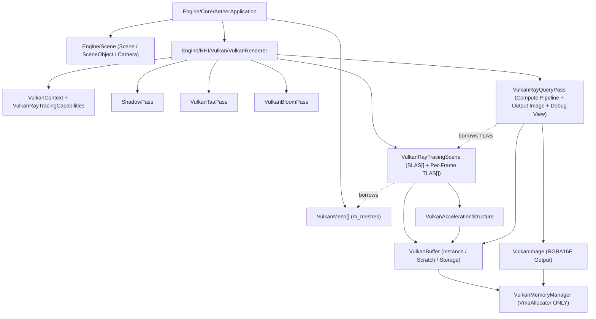

# Aether Engine — Phase 9 前期架构审计报告
## Vulkan Hardware Ray Tracing Foundation（Ray Query + Acceleration Structures）

> **审计声明**：本次审计严格基于 `E:\Aether` 当前仓库源码、Vulkan SDK `1.4.357.0` 头文件、项目内 vendored `vk-bootstrap` 与 `VMA` 源码，以及本机 **NVIDIA GeForce RTX 5090** 的 `vulkaninfoSDK` 实测输出。本次任务为只读审计，未修改任何现有代码、Shader 或构建配置。

---

## 1. 当前架构实际情况

Aether 当前是一套以 **Vulkan 1.3 Dynamic Rendering + Synchronization2** 为核心的单队列光栅化实时渲染引擎（`MAX_FRAMES_IN_FLIGHT = 2`），已完成 Phase 1–8：

```text
ShadowPass (2048² Depth-Only, Opaque/Mask, Per-Frame)
  → HDR Scene Pass (R16G16B16A16_SFLOAT + D32_SFLOAT/D16_UNORM: Skybox + Default/PBR Opaque & Blend, Halton Jitter)
  → VulkanTaaPass (Analytical Skybox + Opaque/Mask Velocity → Ping-Pong HDR Resolve → Depth Copy)
  → VulkanBloomPass (BrightPass → 13-tap Downsample → Separable Gaussian Blur → 9-tap Tent Upsample → HDR Composite)
  → ToneMap (Exposure EV → ACES Filmic → Single sRGB) → Swapchain Present
```

核心现状与约束边界（经源码核实）：
1. **设备与扩展（`Engine/RHI/Vulkan/VulkanContext.cpp:40-238`）**：
   - `vkb::InstanceBuilder` 强制 `require_api_version(1, 3, 0)`，开启验证层与默认 Debug Messenger。
   - `vkb::PhysicalDeviceSelector` 仅要求 Vulkan 1.3 + `VK_KHR_SWAPCHAIN_EXTENSION_NAME` + `VkPhysicalDeviceVulkan13Features{ synchronization2 = VK_TRUE, dynamicRendering = VK_TRUE }`。
   - **未启用** `VkPhysicalDeviceVulkan12Features::bufferDeviceAddress`、**未启用** `VK_KHR_deferred_host_operations` / `VK_KHR_acceleration_structure` / `VK_KHR_ray_query`、**未加载** KHR 扩展函数指针表。
   - 仅检索 `graphics` 与 `present` 队列；在 RTX 5090 上 `m_graphicsQueueFamily = 0`（16 个队列，具备 `GRAPHICS | COMPUTE | TRANSFER | SPARSE_BINDING` 能力），同时支持 Compute Shader 与 Acceleration Structure Build。
2. **内存管理（`Engine/RHI/Vulkan/VulkanMemoryManager.cpp:16-109`）**：
   - 严格只持有 `VmaAllocator`，不创建/不销毁 `VkBuffer` 或 `VkImage`。
   - `VmaAllocatorCreateInfo::flags` 当前为 **0**，**未设置** `VMA_ALLOCATOR_CREATE_BUFFER_DEVICE_ADDRESS_BIT`。
   - `AllocateForBuffer` 直接调用 `vmaAllocateMemoryForBuffer()`，仅满足缓冲区默认 `VkMemoryRequirements::alignment`，**不支持**额外指定对齐（如 `minAccelerationStructureScratchOffsetAlignment`）。
3. **缓冲区与网格（`VulkanBuffer.cpp:11-83`、`VulkanMesh.cpp:12-48`）**：
   - `VulkanBuffer` 未记录 `m_usage`，未提供 `GetDeviceAddress()`。
   - `VulkanMesh` 当前以 `HOST_VISIBLE | HOST_COHERENT` 分配顶点/索引缓冲，usage 仅为 `VERTEX_BUFFER_BIT` / `INDEX_BUFFER_BIT`，**未包含** `SHADER_DEVICE_ADDRESS_BIT` 与 `ACCELERATION_STRUCTURE_BUILD_INPUT_READ_ONLY_BIT_KHR`；仅保存 `m_indexCount`，**未保存** `m_vertexCount`（构建 BLAS 需要 `maxVertex = vertexCount - 1`）。
   - **关键隐性陷阱**：`VulkanMesh.cpp:24` 测试故障注入判断写为 `usage == VK_BUFFER_USAGE_INDEX_BUFFER_BIT`（严格相等而非按位与），若直接追加 RT usage flag 会导致现有 `swapchain.mesh-upload-failure` CTest 失败。
4. **场景与资产（`Scene.h:13-67`、`GltfImporter.h:48-72`、`VulkanAssetUploader.cpp:17-98`）**：
   - `MeshId` 是 `AetherApplication::m_meshes` 的数组下标；每个 `VulkanMesh` 对应 1 个三角形列表（`VK_PRIMITIVE_TOPOLOGY_TRIANGLE_LIST`，`uint32_t` 索引，无多 Submesh）。
   - `SceneObject` 仅保存 `Transform`、`MeshId`、`modelMatrix`、`previousModelMatrix`、`doubleSided`、`material`，**无持久化对象 ID**，**无脏标记**；`Scene::RemoveObject()` 通过 `vector::erase` 移动后续元素下标。
   - 材质的 `AlphaMode`（`Opaque` / `Mask` / `Blend`）存储在 `AetherApplication::m_previewAsset`，不在 `SceneObject` 或 `VulkanMesh` 上。
5. **着色器工具链（`CMakeLists.txt:46-51, 205-290`）**：
   - 使用 Vulkan SDK `1.4.357.0` 自带 DXC `1.9.0.5399`，`add_aether_shader(SOURCE PROFILE OUTPUT [SPIRV_TARGET])` 已参数化 Profile 与 `-fspv-target-env`，可直接支持 `cs_6_5` + `vulkan1.3` 编译 `RayQuery`。

---

## 2. 相关源文件清单

| 分类 | 路径 | 审计关键位置 |
| --- | --- | --- |
| 应用与生命周期 | `Engine/Core/AetherApplication.h`, `Engine/Core/AetherApplication.cpp` | `Initialize` (L53-140)、`AddImportedAsset` (L205-238)、`DrawScene` (L242-322)、`Shutdown` (L556-605) |
| 设备与上下文 | `Engine/RHI/Vulkan/VulkanContext.h`, `Engine/RHI/Vulkan/VulkanContext.cpp` | `Initialize` (L16-63)、`SelectPhysicalDevice` (L128-168)、`CreateLogicalDevice` (L170-238) |
| 内存分配 | `Engine/RHI/Vulkan/VulkanMemoryManager.h`, `Engine/RHI/Vulkan/VulkanMemoryManager.cpp` | `Initialize` (L16-48)、`AllocateForBuffer` (L50-63) |
| 同步与命令 | `Engine/RHI/Vulkan/VulkanSyncManager.cpp`, `Engine/RHI/Vulkan/VulkanCommandManager.cpp` | `MAX_FRAMES_IN_FLIGHT = 2`、Fence/Semaphore/CommandPool |
| 资源抽象 | `Engine/RHI/Vulkan/Resources/VulkanBuffer.h/.cpp`, `VulkanImage.h/.cpp`, `VulkanMesh.h/.cpp` | `VulkanBuffer::Initialize`、`VulkanMesh::Initialize` (L12-40)、`Engine/RHI/BufferHandle.h`（当前未引用） |
| 资产与几何 | `Engine/Renderer/Vertex.h`, `MeshData.h/.cpp`, `Engine/Assets/GltfImporter.h/.cpp`, `Engine/RHI/Vulkan/Assets/VulkanAssetUploader.cpp` | `sizeof(Vertex) == 104`, `offsetof(Vertex, position) == 0`, 静态三角形校验 |
| 场景系统 | `Engine/Scene/Scene.h`, `Transform.h/.cpp`, `Camera.h/.cpp` | `SceneObject` (L20-30), `Scene::RemoveObject` (L41-47), `Camera` 右手系矩阵 |
| 渲染器与 Pass | `Engine/RHI/Vulkan/VulkanRenderer.h/.cpp`, `VulkanIbl.cpp`, `VulkanEnvironment.cpp`, `Passes/ShadowPass.h/.cpp`, `Passes/VulkanBloomPass.h/.cpp`, `Passes/VulkanTaaPass.h/.cpp` | `DrawFrame` (L247-660)、`EnvironmentCommands` (一次性提交)、Compute 管线创建范式（`VulkanIbl.cpp`） |
| 第三方库 | `third_party/vk-bootstrap/src/VkBootstrap.h/.cpp`, `VkBootstrapDispatch.h`; `third_party/vma/include/vk_mem_alloc.h` | `enable_extensions_if_present`, `enable_extension_features_if_present`, `vkb::DispatchTable`, `VMA_ALLOCATOR_CREATE_BUFFER_DEVICE_ADDRESS_BIT` |
| 构建与测试 | `CMakeLists.txt`, `Tests/SwapchainRecovery.cpp`, `Tests/WindowsDesktopValidation.cpp`, `Docs/VulkanValidation.md` | `add_aether_shader`, RTSS 隔离验证启动器 |

---

## 3. Device Feature / Extension 依赖表与 RTX 5090 实测能力

### 3.1 Vulkan 1.3 Core 提升关系与最小必要列表

因 Aether 已要求 **Vulkan 1.3**（`require_api_version(1, 3, 0)`），以下扩展均已提升至 Core 1.2，**不得重复作为 Device Extension 启用**：
- `VK_KHR_buffer_device_address` → **Core 1.2**（仅启用 `VkPhysicalDeviceVulkan12Features::bufferDeviceAddress`）
- `VK_EXT_descriptor_indexing` → **Core 1.2**
- `VK_KHR_spirv_1_4` / `VK_KHR_shader_float_controls` → **Core 1.2**

| 类别 | 名称 | 必须性（Phase 9） | 启用方式与说明 |
| --- | --- | --- | --- |
| **Device Extension** | `VK_KHR_deferred_host_operations` | **必需（RT 模式）** | 未进入 Core 1.3/1.4；`VK_KHR_acceleration_structure` 的规范前置依赖（即使不使用 Host-side Build 也必须启用该扩展） |
| **Device Extension** | `VK_KHR_acceleration_structure` | **必需（RT 模式）** | 提供 BLAS/TLAS 创建、构建、设备地址查询与 `VK_DESCRIPTOR_TYPE_ACCELERATION_STRUCTURE_KHR` |
| **Device Extension** | `VK_KHR_ray_query` | **必需（RT 模式）** | 提供 Compute/Fragment Shader 内联 `RayQuery` 能力（不启用 `VK_KHR_ray_tracing_pipeline`） |
| **Core 1.2 Feature** | `VkPhysicalDeviceVulkan12Features::bufferDeviceAddress` | **必需（RT 模式）** | AS Build Input / Storage / Scratch / Instance Buffer 均依赖 `vkGetBufferDeviceAddress` |
| **Ext Feature** | `VkPhysicalDeviceAccelerationStructureFeaturesKHR::accelerationStructure` | **必需（RT 模式）** | 开启设备侧加速结构构建与着色器读取 |
| **Ext Feature** | `VkPhysicalDeviceRayQueryFeaturesKHR::rayQuery` | **必需（RT 模式）** | 开启着色器内 `OpRayQuery*` 能力 |
| **Core 1.2 Feature** | `descriptorIndexing` / `runtimeDescriptorArray` / `shaderSampledImageArrayNonUniformIndexing` | **Phase 9 可选** | 仅后续 Hybrid RT 材质绑定需要；Phase 9 基础验证无需强制要求，仅查询记录 |
| **Core 1.0/1.2 Feature** | `shaderInt64` | **Phase 9 可选** | 若 Shader 内不直接对 BDA 做 64-bit 地址算术则非必需；如后续扩展顶点属性抓取再按需开启 |

### 3.2 非 RT GPU 优雅降级策略（严格遵守 3A）

禁止使用 `PhysicalDeviceSelector::add_required_extension()` 直接强制 RT 扩展（否则非 RT GPU 会在 `SelectPhysicalDevice()` 阶段直接启动失败）。正确流程：
1. `PhysicalDeviceSelector` 保持现有最小要求（Vulkan 1.3 + Swapchain + `synchronization2` + `dynamicRendering`）选出物理设备。
2. 选出 `m_physicalDevice` 后，调用 `VulkanRayTracingCapabilities::Query(m_physicalDevice)`：
   - 先检查 3 个扩展是否**全部**存在于 `m_physicalDevice.is_extension_present(...)`；
   - 再用 `vkGetPhysicalDeviceFeatures2` 串联 `VkPhysicalDeviceVulkan12Features` + `VkPhysicalDeviceAccelerationStructureFeaturesKHR` + `VkPhysicalDeviceRayQueryFeaturesKHR` 一次性探测所有特性位；
   - 同时用 `vkGetPhysicalDeviceProperties2` 查询 `VkPhysicalDeviceAccelerationStructurePropertiesKHR`；
   - 检查 `m_graphicsQueueFamily` 的 `queueFlags` 包含 `VK_QUEUE_COMPUTE_BIT`（`vkCmdBuildAccelerationStructuresKHR` 强制要求）。
3. **仅当全部 3 扩展 + 3 特性位 + Compute 队列能力均满足时**，再原子调用 `m_physicalDevice.enable_extensions_if_present(...)` 与 `m_physicalDevice.enable_extension_features_if_present(...)`，并将 `caps.supported = true` 写入 `VulkanContext`；否则记录日志并将 `caps.supported = false`，光栅化管线 100% 正常启动。
4. `CreateLogicalDevice()` 成功后，当 `caps.supported == true`，通过 `vkGetDeviceProcAddr`（或 `m_device.make_table()`）加载 5 个必需 KHR 设备函数指针：
   - `vkGetAccelerationStructureBuildSizesKHR`
   - `vkCreateAccelerationStructureKHR`
   - `vkDestroyAccelerationStructureKHR`
   - `vkCmdBuildAccelerationStructuresKHR`
   - `vkGetAccelerationStructureDeviceAddressKHR`

### 3.3 RTX 5090 实测硬件参数（`vulkaninfoSDK.exe`）

| 属性 | RTX 5090 实测值 | 架构影响 |
| --- | --- | --- |
| `apiVersion` | `1.4.357` | 原生满足 Core 1.2/1.3 提升 |
| `VK_KHR_deferred_host_operations` / `acceleration_structure` / `ray_query` | rev 4 / rev 13 / rev 1 | 全部支持 |
| `bufferDeviceAddress` / `accelerationStructure` / `rayQuery` / `descriptorIndexing` | 全部 `true` | 完整支持 |
| `minAccelerationStructureScratchOffsetAlignment` | **`128` bytes** | Scratch 设备地址必须按查询值动态向上对齐（不可硬编码 128） |
| `maxGeometryCount` / `maxInstanceCount` | `16,777,215` | 远超当前场景规模 |
| `maxPrimitiveCount` | `536,870,911` | 远超当前单 Mesh 规模 |
| `maxPerStageDescriptorAccelerationStructures` | `1,048,576` | 单 Descriptor Set 绑定 TLAS 无压力 |
| Queue Family 0 | `16` queues (`GRAPHICS \| COMPUTE \| TRANSFER \| SPARSE`) | 可直接复用 `m_graphicsQueue` 执行 AS Build 与 Ray Query Compute |
| Queue Family 2 | `8` queues (`COMPUTE \| TRANSFER \| SPARSE`) | 未来异步计算扩展预留，Phase 9 不引入跨队列复杂度 |

---

## 4. `VulkanBuffer` 改造需求

审计位置：`Engine/RHI/Vulkan/Resources/VulkanBuffer.h/.cpp`

当前 `VulkanBuffer` 仅保存 `m_memory`, `m_device`, `m_buffer`, `m_allocation`, `m_size`。存在三项明确缺口：
1. **缺少 `GetDeviceAddress()`**：AS Build Input（顶点/索引/实例缓冲）、AS Storage Buffer、Scratch Buffer 均需 `VkDeviceAddress`。
2. **未记录 `m_usage`**：无法在运行时断言缓冲区确实创建了 `VK_BUFFER_USAGE_SHADER_DEVICE_ADDRESS_BIT`。
3. **缺少对齐 Scratch 辅助或自定义对齐分配能力**：`minAccelerationStructureScratchOffsetAlignment`（128/256B）通常大于普通 `VkBuffer` 的 `memoryRequirements.alignment`。

**最小化向后兼容改造方案**：
- 保留现有 `VulkanBuffer::Initialize(...)` 签名不变（调用方按需传入 `usage`，**绝不**默认给所有 Buffer 附加 `SHADER_DEVICE_ADDRESS_BIT` 或 `ACCELERATION_STRUCTURE_BUILD_INPUT_READ_ONLY_BIT_KHR`）。
- 在 `VulkanBuffer` 中新增：
  - `VkBufferUsageFlags m_usage = 0;`（记录创建时的 usage，并在 `Shutdown()` 清零）
  - `VkDeviceAddress GetDeviceAddress() const;`：当 `(m_usage & VK_BUFFER_USAGE_SHADER_DEVICE_ADDRESS_BIT) == 0` 或 `m_buffer == VK_NULL_HANDLE` 时返回 `0`；否则调用 `vkGetBufferDeviceAddress`。
  - 可选：`VkDeviceAddress GetAlignedDeviceAddress(VkDeviceSize alignment) const;`（配合过量分配 `size + alignment - 1` 为 Scratch Buffer 提供无需修改 VMA 块对齐策略的对齐地址，或由 `VulkanMemoryManager::AllocateForBufferAligned` 保证起始地址对齐，详见第 5 节）。
- 对 5 类 RT 相关缓冲区的 Usage / Memory 策略划分：

| 缓冲区用途 | `VkBufferUsageFlags` | 内存属性 | 是否需要 BDA |
| --- | --- | --- | --- |
| 普通 Staging / Readback / UBO（现有） | 保持不变 | 保持不变 | **否** |
| RT-enabled `VulkanMesh` 顶点缓冲 | `VERTEX_BUFFER_BIT \| SHADER_DEVICE_ADDRESS_BIT \| ACCELERATION_STRUCTURE_BUILD_INPUT_READ_ONLY_BIT_KHR`（仅 RT 启用时追加） | `HOST_VISIBLE \| HOST_COHERENT`（Phase 9.1 复用现有上传路径；后续可升级 `DEVICE_LOCAL`） | 仅 RT 启用时 |
| RT-enabled `VulkanMesh` 索引缓冲 | `INDEX_BUFFER_BIT \| SHADER_DEVICE_ADDRESS_BIT \| ACCELERATION_STRUCTURE_BUILD_INPUT_READ_ONLY_BIT_KHR`（仅 RT 启用时追加） | 同上 | 仅 RT 启用时 |
| AS Storage Buffer（BLAS / TLAS 底层存储） | `ACCELERATION_STRUCTURE_STORAGE_BIT_KHR \| SHADER_DEVICE_ADDRESS_BIT` | `DEVICE_LOCAL` | **是** |
| AS Scratch Buffer（BLAS / TLAS 构建临时区） | `STORAGE_BUFFER_BIT \| SHADER_DEVICE_ADDRESS_BIT` | `DEVICE_LOCAL` | **是** |
| TLAS Instance Buffer（每帧槽独立） | `ACCELERATION_STRUCTURE_BUILD_INPUT_READ_ONLY_BIT_KHR \| SHADER_DEVICE_ADDRESS_BIT` | `HOST_VISIBLE \| HOST_COHERENT`（CPU 每帧写入 `VkAccelerationStructureInstanceKHR[]`） | **是** |

> 注：`Engine/RHI/BufferHandle.h` 当前在仓库中无任何引用，Phase 9 不应强行绑定或删除它。

---

## 5. VMA 与 `VulkanMemoryManager` 配置需求

审计位置：`Engine/RHI/Vulkan/VulkanMemoryManager.h/.cpp`、`third_party/vma/include/vk_mem_alloc.h:430-446, 12087-12095`

1. **必须条件启用 `VMA_ALLOCATOR_CREATE_BUFFER_DEVICE_ADDRESS_BIT`**：
   - 核实 VMA 源码（`vk_mem_alloc.h:12090-12094`）：仅当 `VmaAllocatorCreateInfo::flags` 包含 `VMA_ALLOCATOR_CREATE_BUFFER_DEVICE_ADDRESS_BIT` 时，VMA 才会在 `vkAllocateMemory` 的 `pNext` 中自动附加 `VkMemoryAllocateFlagsInfo{ VK_MEMORY_ALLOCATE_DEVICE_ADDRESS_BIT }`。
   - 若未设置该标志而为 `VK_BUFFER_USAGE_SHADER_DEVICE_ADDRESS_BIT` 的缓冲区调用 `vkGetBufferDeviceAddress`，Vulkan Validation 会直接报错（`VUID-vkGetBufferDeviceAddress-bufferDeviceAddress-03324` / `VUID-vkBindBufferMemory-bufferDeviceAddress-03339`）。
   - **关键约束**：按 `vk_mem_alloc.h:433-438`，该标志只能在设备实际启用了 `bufferDeviceAddress` 特性时设置！因此 `VulkanMemoryManager::Initialize(const VulkanContext& context)` 改为：
     ```cpp
     if (context.GetRayTracingCapabilities().bufferDeviceAddressEnabled)
         allocatorCreateInfo.flags |= VMA_ALLOCATOR_CREATE_BUFFER_DEVICE_ADDRESS_BIT;
     ```
2. **保持严格所有权边界**：
   - `VulkanMemoryManager` **不新增任何 AS 语义方法**，不持有 `VkAccelerationStructureKHR`，不了解 BLAS/TLAS/Mesh/Scene。
3. **Scratch 对齐处理（二选一，推荐方案 A）**：
   - **方案 A（零 VMA 接口改动，推荐）**：Scratch Buffer 由调用方（AS Builder/Pass）按 `scratchSize + (minAlign - 1)` 申请普通 `VulkanBuffer`，构建时将 `scratchDeviceAddress` 向上圆整到 `minAlign` 倍数：`(addr + minAlign - 1) & ~(minAlign - 1)`。完全不侵入 `VulkanMemoryManager`，对任何 `minAlign`（128/256B）天然合法。
   - **方案 B**：在 `VulkanMemoryManager` 增加 `AllocateForBufferWithAlignment(VkBuffer, VkDeviceSize minAlignment, ...)`（内部先调 `vkGetBufferMemoryRequirements`，放大 `req.alignment = std::max(req.alignment, minAlignment)` 后调 `vmaAllocateMemory`）。比方案 A 多一个接口但节省至多 `minAlign - 1` 字节。
   - **结论**：优先采用方案 A，更简单且零接口膨胀。

---

## 6. BLAS / TLAS 所有权设计与候选模块裁剪

### 6.1 候选模块评估（防过度设计、防 God Manager）

| 候选模块 | 决策 | 职责与理由 |
| --- | --- | --- |
| **`VulkanRayTracingCapabilities`**（轻量值结构，放 `Engine/RHI/Vulkan/VulkanRayTracingCapabilities.h` 或内嵌于 `VulkanContext`） | **独立头文件（轻量结构体 + 函数表）** | 封装 `supported`、核心/扩展特性结果、`VkPhysicalDeviceAccelerationStructurePropertiesKHR`（`minScratchAlignment`、`maxGeometryCount`、`maxInstanceCount`、`maxPrimitiveCount`）及 5 个 `PFN_vk*KHR` 函数指针。由 `VulkanContext` 持有只读副本并暴露 `GetRayTracingCapabilities()`。 |
| **`VulkanAccelerationStructure`**（`Engine/RHI/Vulkan/Resources/VulkanAccelerationStructure.h/.cpp`） | **必须独立** | 严格对标 `VulkanImage` / `VulkanBuffer` 的资源所有权层：组合 1 个底层存储 `VulkanBuffer m_storageBuffer`（通过 `VulkanMemoryManager` 分配）+ 持有 1 个 `VkAccelerationStructureKHR m_handle` + `VkDeviceAddress m_deviceAddress` + `VkAccelerationStructureTypeKHR` + 元数据（`size`、`allowUpdate`）。析构/Shutdown 严格按序：**先 `vkDestroyAccelerationStructureKHR`，再 `m_storageBuffer.Shutdown()`**。 |
| **`VulkanBlasManager` & `VulkanTlasManager`** | **合并为单一精简模块 `VulkanRayTracingScene`（或仅保留 `VulkanBlasCache` + `VulkanTlasBuilder` 二选一；Phase 9 推荐合并为一个专责 AS 编排类 `VulkanAccelerationStructureSet` / `VulkanRayTracingScene`）** | 理由：在 Phase 9（单队列、静态三角形 BLAS、每帧槽 TLAS）中，若拆为两个独立 Manager，会导致 BLAS 数组索引、TLAS 对 BLAS deviceAddress 的引用、场景替换时的同步失效分散在两处反而增加耦合与生命周期错配风险。用一个专责对象管理“每 Mesh 一个 BLAS + 每帧槽一个 TLAS/Instance/Scratch”更符合 Aether 现有的 `VulkanMaterialSet` / `ShadowPass` 粒度。若未来 Phase 10 引入异步流式 BLAS 压缩或蒙皮动态 BLAS，再按需拆分。 |
| **`VulkanRayQueryPass`**（`Engine/RHI/Vulkan/Passes/VulkanRayQueryPass.h/.cpp`） | **必须独立** | 严格对标 `VulkanBloomPass` / `VulkanTaaPass`：拥有 Compute Shader Pipeline、Descriptor Set Layout/Pool/Sets（Binding 0: TLAS、Binding 1: 输出 `RGBA16F` Storage Image、Binding 2: 相机/参数 UBO 或 Push Constants）、全屏调试可视化合成管线（复用已有全屏三角形）、GPU Timestamp QueryPool（独立统计 BLAS/TLAS/RayQuery 耗时）。**不拥有** BLAS/TLAS，只借用 `VkAccelerationStructureKHR`。 |

### 6.2 资源所有权归属总表

- **`VulkanContext`**：拥有 `VkDevice`、只读 `VulkanRayTracingCapabilities`（含 KHR 函数表）。
- **`VulkanMemoryManager`**：仅拥有 `VmaAllocator`。
- **`AetherApplication`**：拥有 `m_meshes`（`std::vector<std::unique_ptr<VulkanMesh>>`）与 `Scene`（CPU 数据）。
- **`VulkanAccelerationStructure`**：拥有 `VkAccelerationStructureKHR` 与底层 `VulkanBuffer`（内存通过 `VulkanMemoryManager` 释放）。
- **`VulkanRayTracingScene`**（由 `VulkanRenderer` 持有并在 `Shutdown()` 中先于 `VulkanMemoryManager` 销毁，或在 `AetherApplication` 中与 `m_meshes` 同寿命管理 — **详见下方权衡**）：
  - **推荐归属：`VulkanRenderer` 持有 `VulkanRayTracingScene` 与 `VulkanRayQueryPass`**（与 `m_shadowPass` / `m_taaPass` / `m_bloomPass` 完全一致！），`AetherApplication` 仅在 `CreateScene()` / `AddImportedAsset()` 完成 `m_meshes` 上传后通知 `m_renderer.RebuildBlas(m_meshes)`，每帧 `DrawFrame()` 传入只读 `DrawItem`（已有 `mesh` 指针 / `MeshId` + `model` + `alphaMask` + `doubleSided`）。
  - **重要所有权校验**：`VulkanRayTracingScene` 绝不拥有 `VulkanMesh`；当 `AetherApplication::AddImportedAsset()` 在 `vkDeviceWaitIdle()` 后替换 `m_meshes` 时，必须先通知 `m_renderer.ClearBlas()`（或 `RebuildBlas(m_meshes)`）销毁旧 BLAS，再销毁旧 `m_meshes`（或确保不再有命令缓冲引用旧 BLAS），绝不残留悬空指针。

---

## 7. Mesh / Asset 与 Scene 映射方案

### 7.1 `MeshData` / `VulkanMesh` → BLAS Geometry 映射

经核查 `Engine/Renderer/Vertex.h`、`MeshData.cpp` 与 `GltfImporter.cpp:94-185`：
- 顶点结构体 `Vertex`：
  - `position`：`glm::vec3`，`offsetof(Vertex, position) == 0`，格式 `VK_FORMAT_R32G32B32_SFLOAT`
  - `sizeof(Vertex) == 104`（4 字节对齐，满足 `vertexStride` 规范要求）
- 索引格式：固定 `uint32_t`（`VK_INDEX_TYPE_UINT32`），拓扑固定 `TRIANGLE_LIST`（`GltfImporter.cpp:98` 已拒绝非三角形与 morph targets，`MeshData::IsValid()` 已校验 `indices.size() % 3 == 0` 且全索引 `< vertices.size()`）。
- **需补充的最小元数据**：在 `VulkanMesh` 新增 `uint32_t m_vertexCount = 0;` 与 `GetVertexCount() const`，因为 `VkAccelerationStructureGeometryTrianglesDataKHR` 要求：
  - `vertexFormat = VK_FORMAT_R32G32B32_SFLOAT`
  - `vertexData.deviceAddress = mesh.GetVertexBuffer().GetDeviceAddress()`
  - `vertexStride = sizeof(Vertex)`
  - `maxVertex = mesh.GetVertexCount() - 1`
  - `indexType = VK_INDEX_TYPE_UINT32`
  - `indexData.deviceAddress = mesh.GetIndexBuffer().GetDeviceAddress()`
  - `primitiveCount = mesh.GetIndexCount() / 3`
  - `firstVertex = 0`, `primitiveOffset = 0`, `transformData = {0}`
- **不支持的几何处理**：若某 `VulkanMesh` 顶点/索引缓冲未启用 `SHADER_DEVICE_ADDRESS_BIT`、`vertexCount == 0`、`indexCount < 3`、`indexCount % 3 != 0` 或 `primitiveCount > caps.maxPrimitiveCount`，安全跳过并输出诊断错误，绝不传入非法参数触发崩溃/验证错误。
- **BLAS 复用**：每个 `VulkanMesh`（对应一个 `MeshId`）仅构建 **1 个 BLAS**。默认演示场景中两个立方体共享同一个 `cubeId`，因此天然共享 1 个 BLAS、在 TLAS 中产生 2 个 `VkAccelerationStructureInstanceKHR`！glTF 多节点引用同一 primitive 同理自动复用 BLAS。

### 7.2 `SceneObject` → `VkAccelerationStructureInstanceKHR` 映射

| `VkAccelerationStructureInstanceKHR` 字段 | 映射来源 | 说明 |
| --- | --- | --- |
| `transform` (`VkTransformMatrixKHR`, row-major `3×4`) | `glm::transpose(object.GetModelMatrix())` 前 3 行 | **必须转置**（GLM 列主序 → Vulkan 行主序 `3×4`） |
| `instanceCustomIndex` (24-bit) | `objectIndex`（或 `meshId`，按需约定：Phase 9 建议填 `objectIndex & 0xFFFFFFu`） | RayQuery 中可通过 `CommittedInstanceID()` 读取，用于调试可视化与后续材质表索引 |
| `mask` (8-bit) | Opaque/Mask = `0xFF`，`AlphaMode::Blend` = `0x00`（Phase 9 可选跳过或设 `0x01` 供筛选） | 支持按射线掩码剔除透明/特殊对象 |
| `instanceShaderBindingTableRecordOffset` (24-bit) | `0` | Phase 9 不使用 RT Pipeline / SBT，固定为 0 |
| `flags` (8-bit) | `doubleSided` → `VK_GEOMETRY_INSTANCE_TRIANGLE_FACING_CULL_DISABLE_BIT_KHR`<br>`det(model) < 0` → `VK_GEOMETRY_INSTANCE_TRIANGLE_FLIP_FACING_BIT_KHR`<br>`Opaque` → `VK_GEOMETRY_INSTANCE_FORCE_OPAQUE_BIT_KHR`<br>`Mask` → `VK_GEOMETRY_INSTANCE_FORCE_NO_OPAQUE_BIT_KHR` | 通过实例级不透明标志覆写 BLAS，允许同一 BLAS 复用在不同材质（Opaque / Mask）实例上，无需重建 BLAS！ |
| `accelerationStructureReference` (`uint64_t`) | `blas[meshId]->GetDeviceAddress()` | 通过 `vkGetAccelerationStructureDeviceAddressKHR` 获取 |

- **AlphaMode 处理策略**：
  - `Opaque`：设置 `FORCE_OPAQUE`，硬件遍历直接提交命中，零着色器回调开销。
  - `Mask`：设置 `FORCE_NO_OPAQUE`，Phase 9 基础验证阶段可按几何命中提交（`CommitNonOpaqueTriangleHit()`）或在后续接入 BaseColor 采样裁剪；文档明确说明 Phase 9.1 基础验证不引入完整纹理 Bindless 表。
  - `Blend`：默认不写入 TLAS 实例（与 `ShadowPass` / `VulkanTaaPass` 一致）或使用独立 `mask` 位跳过，防止半透明挡住不透明几何光线。
- **TLAS Rebuild vs Update 触发条件**：
  - **Rebuild（`VK_BUILD_ACCELERATION_STRUCTURE_MODE_BUILD_KHR`）**：首次构建、实例数量变化、实例关联的 BLAS 变更、实例 flags 变更、或 `Scene` 结构变动（`AddObject` / `RemoveObject` / 场景替换）时触发；同时申请 `VK_BUILD_ACCELERATION_STRUCTURE_ALLOW_UPDATE_BIT_KHR | VK_BUILD_ACCELERATION_STRUCTURE_PREFER_FAST_TRACE_BIT_KHR`。
  - **In-Place Update（`VK_BUILD_ACCELERATION_STRUCTURE_MODE_UPDATE_KHR`）**：仅当**当前帧槽 `f` 的 `tlas[f]`** 上一次已成功构建、实例数量及每实例的 `(blasAddress, flags)` 拓扑完全未变、且仅 `transform` 矩阵发生变化时，可对 `tlas[f]` 执行原地更新（`srcAccelerationStructure = dstAccelerationStructure = tlas[f]`）。
  - **空 Scene（`instanceCount == 0`）**：不执行无效实例缓冲访问；设置 `tlasValid = false`，RayQuery Compute Shader 直接输出全 Miss 背景，避免空引用崩溃。

---

## 8. 多帧同步设计（`MAX_FRAMES_IN_FLIGHT = 2`）

当前同步基线：`VulkanRenderer::DrawFrame` 在每帧开头等待 `m_syncManager->GetInFlightFence(m_currentFrame)`，单队列 `m_graphicsQueue` 串行提交。

### 8.1 帧并发资源隔离（禁止每帧 `vkDeviceWaitIdle`）

1. **Per-Frame-In-Flight TLAS 组（`[0]`, `[1]`）**：
   - `tlas[f]`（`VulkanAccelerationStructure`）
   - `instanceBuffer[f]`（Host-Visible Coherent `VulkanBuffer`，按需倍增扩容，仅当容量不足时重建，不逐帧分配）
   - `tlasScratchBuffer[f]`（Device-Local `VulkanBuffer`，按需倍增扩容，不逐帧分配）
   - `rayQueryDescriptorSet[f]`（绑定 `tlas[f]`、输出图像与 UBO；仅在 `tlas[f]` 句柄重建或输出图像 Resize 时更新，不逐帧重分配）
   - **安全性证明**：帧槽 `f` 在等待 `inFlightFence[f]` 之后才由 CPU 写入 `instanceBuffer[f]` 并录制 `tlas[f]` 构建与 RayQuery 命令；此时在途的另一帧 `1 - f` 正在读写 `instanceBuffer[1 - f]` / `tlas[1 - f]` / `tlasScratchBuffer[1 - f]`，**完全零共享、零数据竞争**！
2. **BLAS 生命周期与 Scratch 安全**：
   - 场景初始化或导入新资产时（此时 `AetherApplication` 已处于非渲染阶段或已执行场景切换同步），通过一次性命令缓冲（复用 `VulkanRenderer::EnvironmentCommands` 范式，带专用局部 Fence 而非阻塞无关队列）构建全部静态 BLAS，构建完成后再释放临时 BLAS Scratch Buffer。
   - 若未来支持渲染帧内动态新增 Mesh 的延迟 BLAS 构建，必须将 BLAS Scratch Buffer 挂载至当前帧槽 `f` 的延迟回收队列，待下一次 `inFlightFence[f]` 通过后再释放，**严禁在录制完命令后立即销毁 Scratch Buffer**。
3. **精确 Synchronization2 屏障链（全部在同一主图形命令缓冲中）**：

```text
[阶段 1: 可选延迟 BLAS Build]
   │  VkMemoryBarrier2:
   │    srcStage  = VK_PIPELINE_STAGE_2_ACCELERATION_STRUCTURE_BUILD_BIT_KHR
   │    srcAccess = VK_ACCESS_2_ACCELERATION_STRUCTURE_WRITE_BIT_KHR
   │    dstStage  = VK_PIPELINE_STAGE_2_ACCELERATION_STRUCTURE_BUILD_BIT_KHR
   │    dstAccess = VK_ACCESS_2_ACCELERATION_STRUCTURE_READ_BIT_KHR
   ▼
[阶段 2: Per-Frame TLAS Build / Update (tlas[f])]
   │  VkMemoryBarrier2:
   │    srcStage  = VK_PIPELINE_STAGE_2_ACCELERATION_STRUCTURE_BUILD_BIT_KHR
   │    srcAccess = VK_ACCESS_2_ACCELERATION_STRUCTURE_WRITE_BIT_KHR
   │    dstStage  = VK_PIPELINE_STAGE_2_COMPUTE_SHADER_BIT
   │    dstAccess = VK_ACCESS_2_ACCELERATION_STRUCTURE_READ_BIT_KHR
   ▼
[阶段 3: VulkanRayQueryPass Compute Dispatch (写入 rayQueryOutput[f], GENERAL)]
   │  VkImageMemoryBarrier2 (rayQueryOutput[f]: GENERAL → SHADER_READ_ONLY_OPTIMAL):
   │    srcStage  = VK_PIPELINE_STAGE_2_COMPUTE_SHADER_BIT
   │    srcAccess = VK_ACCESS_2_SHADER_STORAGE_WRITE_BIT
   │    dstStage  = VK_PIPELINE_STAGE_2_FRAGMENT_SHADER_BIT
   │    dstAccess = VK_ACCESS_2_SHADER_SAMPLED_READ_BIT
   ▼
[阶段 4: 可选调试叠加/直通 ToneMap 显示 (rayQueryOutput[f] 只读采样)]
```

4. **Resize / 场景重建 / 对象销毁 / 关闭销毁顺序**：
   - **Resize**：`VulkanContext::RecreateSwapchain` 已等待设备空闲；`VulkanRayQueryPass::OnResize(newExtent)` 仅重建输出存储图像及对应描述集，**无需重建 BLAS 或 TLAS**！
   - **场景重建（`AddImportedAsset`）**：`AetherApplication::AddImportedAsset()` 已在切换前调用 `vkDeviceWaitIdle`（`AetherApplication.cpp:225`）；在此之后先重建/清理 BLAS，再交换 `m_meshes`，下一帧自动触发 `tlas[0]`、`tlas[1]` 全量 Rebuild。
   - **关闭顺序（`AetherApplication::Shutdown`）**：
     `WaitIdle()` → `m_renderer.Shutdown()`（内部先销毁 `m_rayQueryPass` → `m_rtScene`（先 `tlas[]` 后 `blas[]`，每个 AS 先 `vkDestroyAccelerationStructureKHR` 再释放其 `m_storageBuffer`）→ `m_shadowPass` / `m_bloomPass` / `m_taaPass` / HDR / Depth）→ 清理 `m_meshes` → `Sync` → `Command` → `VulkanMemoryManager::Shutdown()` → `VulkanContext::Shutdown()`。

---

## 9. 模块依赖关系图



---

## 10. 建议新增与修改的文件清单

### 建议新增文件
1. `Engine/RHI/Vulkan/VulkanRayTracingCapabilities.h` / `.cpp` — RT 扩展/特性探测、属性查询与 KHR 函数指针表。
2. `Engine/RHI/Vulkan/Resources/VulkanAccelerationStructure.h` / `.cpp` — 单一 AS 资源对象（`VkAccelerationStructureKHR` + 存储 `VulkanBuffer` + DeviceAddress）。
3. `Engine/RHI/Vulkan/RayTracing/VulkanRayTracingScene.h` / `.cpp` — BLAS 集合构建/管理 + 每帧槽 TLAS 构建/更新 + Instance/Scratch 缓冲管理 + Timestamp 埋点。
4. `Engine/RHI/Vulkan/Passes/VulkanRayQueryPass.h` / `.cpp` — 最小可验证 Ray Query Compute Pass（输出 Hit/Miss、Hit Distance、Primitive Index 可视化模式 + 可选调试视图切换 + Timestamp 埋点）。
5. `Engine/Renderer/RayTracingConfig.h` — 纯 CPU 配置与矩阵转换/对齐辅助（`RayQueryDebugMode`、`ToVkTransformMatrix`、`AlignUp`、`SanitizeRayTracingConfig`，供 CPU 单元测试）。
6. `Shaders/rayquery_debug.comp.hlsl` — `cs_6_5` RayQuery Compute Shader（主相机射线生成 + `RayQuery<RAY_FLAG_NONE>` 遍历 TLAS + 输出 Hit/Miss、归一化 Hit Distance、Primitive Index 伪彩）。
7. `Tests/RayTracingMathTests.cpp` — 纯 CPU 单元测试（对齐、3×4 转置、实例标志映射、空场景/超限防护）。
8. `Tests/RayTracingTests.cpp` — GPU 生命周期、Synchronization Validation、Readback 数值验证（Hit/Miss/Distance/PrimitiveID 正确性）与多场景 Timestamp 基准测试。

### 必须修改的现有文件（最小改动面）
1. `Engine/RHI/Vulkan/VulkanContext.h` / `.cpp` — 可选探测并启用 RT 扩展/特性、填充 `VulkanRayTracingCapabilities`、加载 5 个 KHR 函数指针。
2. `Engine/RHI/Vulkan/VulkanMemoryManager.cpp` — 仅在 `context.GetRayTracingCapabilities().bufferDeviceAddressEnabled` 时为 VMA 追加 `VMA_ALLOCATOR_CREATE_BUFFER_DEVICE_ADDRESS_BIT`。
3. `Engine/RHI/Vulkan/Resources/VulkanBuffer.h` / `.cpp` — 记录 `m_usage`，新增 `GetDeviceAddress()`。
4. `Engine/RHI/Vulkan/Resources/VulkanMesh.h` / `.cpp` — 记录 `m_vertexCount`，允许可选追加 `SHADER_DEVICE_ADDRESS_BIT | ACCELERATION_STRUCTURE_BUILD_INPUT_READ_ONLY_BIT_KHR`（仅 RT 开启时传入），并**修复 L24 `usage == VK_BUFFER_USAGE_INDEX_BUFFER_BIT` 为按位与 `(usage & VK_BUFFER_USAGE_INDEX_BUFFER_BIT) != 0`**。
5. `Engine/RHI/Vulkan/Assets/VulkanAssetUploader.h` / `.cpp` — 透传 `bool enableRayTracingUsage` 给 `VulkanMesh::Initialize`。
6. `Engine/RHI/Vulkan/VulkanRenderer.h` / `.cpp` — 条件初始化 `VulkanRayTracingScene` 与 `VulkanRayQueryPass`（非 RT GPU 自动跳过）、在 `DrawFrame` 中并行调度 TLAS + RayQuery（支持热键切换调试可视化，如未占用键 **`Q`**）、正确接入 Resize 与 Shutdown 顺序。
7. `Engine/Core/AetherApplication.h` / `.cpp` — 传参启用 RT Mesh Usage、场景创建/拖放替换后触发 `RebuildBlas`、新增热键（建议 **`Q`** 循环切换 Off → Hit/Miss → Hit Distance → Primitive Index）。
8. `CMakeLists.txt` — 添加 `rayquery_debug.comp.hlsl`（`cs_6_5`, `vulkan1.3`）、注册 `AetherRayTracingMathTests` 与 `rt.gpu` / `rt.visual` CTest。
9. `ARCHITECTURE.md` / `README.md` — 同步文档。

### 可保持完全不变的模块
- `Engine/Platform/Window.*`
- `Engine/Scene/Camera.*`, `OrbitCameraController.*`, `Transform.*`, `Scene.h`（Phase 9 无需改动 `Scene.h` 即可由 `AetherApplication` 映射 `SceneObject` → 实例列表！）
- `Engine/Assets/GltfImporter.*`, `ObjImporter.*`, `HdrImage.*`, `ImageDecoder.*`, `MaterialStudy.*`
- `Engine/Renderer/Vertex.h`, `MeshData.*`, `DirectionalShadow.*`, `Passes/ShadowPass.*`, `Passes/BloomPass.*`, `Passes/TaaPass.*`
- `Engine/RHI/Vulkan/Resources/VulkanImage.*`, `VulkanTexture.*`, `VulkanShadowMap.*`
- `Engine/RHI/Vulkan/Assets/VulkanMaterialSet.*`, `VulkanEnvironment.*`
- `Engine/RHI/Vulkan/Pipeline/VulkanGraphicsPipeline.*`, `VulkanShader.*`
- `Engine/RHI/Vulkan/Passes/VulkanBloomPass.*`, `VulkanTaaPass.*`
- `Engine/RHI/Vulkan/VulkanCommandManager.*`, `VulkanSyncManager.*`, `VulkanPbr.cpp`, `VulkanHdrPass.cpp`, `VulkanIbl.cpp`, `VulkanTextureUpload.cpp`
- 全部现有光栅化与后处理 Shader（`triangle.*`, `pbr.*`, `skybox.*`, `tonemap.*`, `ibl.*`, `shadow*`, `bloom*`, `taa*`）

---

## 11. Phase 9 最小可验证 Ray Query 工作流与分阶段实施计划

### 最小可验证工作流（并行运行于现有光栅化管线）
1. 为场景中每个 `VulkanMesh` 构建 1 个 BLAS；多实例复用同一 BLAS。
2. 每帧为当前帧槽 `f` 填充 `VkAccelerationStructureInstanceKHR[]`，执行 `tlas[f]` Build/Update。
3. 在 `rayquery_debug.comp.hlsl`（`cs_6_5`，工作组 `8×8`）中从相机逆 VP 发射主射线：
   - 调用 `RayQuery<RAY_FLAG_NONE>` 遍历 `tlas[f]`；
   - 记录并按模式输出至 `R16G16B16A16_SFLOAT` Storage Image：
     - 模式 1（Hit / Miss）：命中绿、未命中暗蓝；
     - 模式 2（Hit Distance）：`CommittedRayT()` 线性/对数映射灰度（同时可供 GPU Readback 校验与解析距离误差 `< 1e-3`）；
     - 模式 3（Primitive Index）：`CommittedPrimitiveIndex()` + `CommittedInstanceID()` 哈希着色（可精确读回验证三角形索引与实例 ID）。
4. 调试模式关闭时仅可按需运行验证（或完全旁路），调试模式开启时将 `rayQueryOutput[f]` 直接送入 `ToneMap` 显示，与现有光栅化 PBR/Shadow/Bloom/TAA 互不干扰。

### 可独立验收的 4 个实施阶段

| 阶段 | 范围 | 独立验收标准 |
| --- | --- | --- |
| **Phase 9A：能力探测、VMA/Buffer/Mesh 准备** | `VulkanRayTracingCapabilities`、`VulkanContext` 可选启用、`VulkanMemoryManager` 条件 BDA、`VulkanBuffer::GetDeviceAddress`、`VulkanMesh` 顶点计数 + RT Usage（修复 L24 故障注入判断）、`RayTracingConfig` + CPU 测试 | 现有 9 CPU + 19 GPU 回归 100% 通过；RTX 5090 正确打印 RT 能力与 `minScratchAlignment = 128`；新增 `rt.math` CPU 测试通过；强制关闭 RT 开关时纯光栅化 100% 正常启动 |
| **Phase 9B：BLAS / TLAS 资源与多帧构建** | `VulkanAccelerationStructure`、`VulkanRayTracingScene`（BLAS 构建、每帧槽 TLAS Build/Update、Scratch 对齐、空场景/多实例/动态变换/删除） | GPU 测试 `rt.as` 通过：BLAS/TLAS 创建销毁 0 VMA 泄漏、单 Mesh 多实例、空 Scene、动态增删对象、1000+ 大规模实例、12+ 帧并发 0 Validation / Sync 错误 |
| **Phase 9C：Ray Query Compute Pass 与数值验证** | `rayquery_debug.comp.hlsl`（`cs_6_5`）、`VulkanRayQueryPass`、热键 `Q` 调试可视化、GPU 精确读回测试 | GPU Readback 精确验证：中心像素 Hit、角落像素 Miss、实测 `CommittedRayT()` 匹配解析几何距离、多实例 `CommittedInstanceID()` 与 `CommittedPrimitiveIndex()` 正确、Resize 正常、0 Validation / Sync 错误 |
| **Phase 9D：视觉验收、基准测试与文档回归** | RTX 5090 对比截图（默认场景 + `DamagedHelmet.glb` 的 Hit/Miss、Distance、PrimitiveID 可视化）、GPU Timestamp 基准（BLAS Build / TLAS Build / TLAS Update / Ray Query Dispatch）、全量隔离回归、更新 `ARCHITECTURE.md` / `README.md` | 实机截图肉眼验收通过、实测 Timestamp 数据归档、全部 CPU + 隔离 GPU + 桌面压测 0 失败 0 Validation 错误 |

---

## 12. 风险分析

| 风险级别 | 风险描述 | 代码依据与缓解方案 |
| --- | --- | --- |
| **高（致命）** | **多帧并发下的 Host→Device TLAS/Instance/Scratch 竞态** | `MAX_FRAMES_IN_FLIGHT = 2` 下若共享单份 `instanceBuffer` 或 `tlas`，CPU 写下一帧实例会直接破坏上一帧在途的 `vkCmdBuildAccelerationStructuresKHR`。**必须**按 `framesInFlight` 分配独立 `tlas[f]`、`instanceBuffer[f]`、`tlasScratchBuffer[f]` 与 `descriptorSet[f]`。 |
| **高（致命）** | **Scratch 缓冲对齐违例与提前释放（Use-After-Free）** | `VulkanMemoryManager::AllocateForBuffer` 仅保证 `VkMemoryRequirements::alignment`（常为 16/64B），小于 RTX 5090 的 `minAccelerationStructureScratchOffsetAlignment = 128`（其他 GPU 可达 256B）；且在命令缓冲执行完前销毁局部 Scratch 会直接导致设备丢失/验证报错。**必须**用 `size + minAlign - 1` 向上对齐设备地址，并严格绑定 Scratch 生命周期至对应 Fence。 |
| **高（静默回归）** | **`VulkanMesh.cpp:24` 严格相等判断破坏现有测试 + 非 RT GPU 退化失败** | `VulkanMesh.cpp:24` 写为 `usage == VK_BUFFER_USAGE_INDEX_BUFFER_BIT`，追加 RT flag 会静默破坏 `swapchain.mesh-upload-failure`；同时若在 `VMA` 无条件开启 `VMA_ALLOCATOR_CREATE_BUFFER_DEVICE_ADDRESS_BIT` 或在 `PhysicalDeviceSelector` 强制 RT 扩展，会导致不支持 RT 的 GPU 崩溃或启动失败。**必须**改用按位与并全部按 `caps.supported` 条件启用。 |
| **中** | **GLM 列主序与 `VkTransformMatrixKHR` 行主序混淆** | 未转置直接拷贝会导致缩放/平移错位、光线命中位置完全错误。通过 `RayTracingConfig` 统一封装 `ToVkTransformMatrix` 并由 CPU 单元测试严格锁死。 |
| **中** | **`Scene::RemoveObject` 导致实例下标漂移影响 TLAS Update** | `Scene.h:41-47` 删除元素会平移后续索引，若盲目触发 `MODE_UPDATE_KHR` 会触发 Vulkan 未定义行为（实例 BLAS 拓扑改变）。仅当每实例 `(blasAddress, flags)` 与该帧槽上次构建完全一致时允许 `UPDATE`，否则自动回退 `BUILD`。 |
| **中（待确认）** | **DXC `cs_6_5` 在 `-fspv-target-env=vulkan1.3` 下是否需要额外 `-fspv-extension=SPV_KHR_ray_query` 标志** | 本次为只读审计，未实际编译 `RayQuery` HLSL 文件；标记为 **待确认**（DXC 1.9 在 `vulkan1.3` + `cs_6_5` 下通常自动启用 `SPV_KHR_ray_query`，Phase 9C 首个编译步骤将实测确认）。 |
| **低** | **现有 `VulkanMesh` 使用 `HOST_VISIBLE` 内存做 BLAS 输入** | Vulkan 规范允许，但首次 BLAS 构建带宽略低于 `DEVICE_LOCAL`；因静态 BLAS 仅构建一次，Phase 9 可先复用现有上传逻辑，后续按需迁移 `VulkanMesh` 到 `DEVICE_LOCAL` staging。 |

---

## 13. 自动化测试与性能测试方案

### 13.1 CPU 单元测试（`AetherRayTracingMathTests` / CTest `rt.math`）
- `AlignUp()` 对 128 / 256 / 非 2 次幂边界校验。
- `ToVkTransformMatrix()` 对平移、旋转、非均匀缩放、负行列式镜像矩阵的逐元素校验。
- 实例标志映射（`doubleSided`、`mirrored`、`Opaque`、`Mask`）。
- 配置清洗与非有限值拦截。

### 13.2 GPU 与同步验证测试（`rt.gpu` / `rt.visual`，通过 `validation-launch.exe isolated` 运行，`VK_LAYER_VALIDATE_SYNC=1`）
- **资源生命周期与 VMA 零泄漏**：连续 5 轮 BLAS + TLAS 创建与销毁，断言 `m_memoryManager.GetAllocationCountForTest()` 精确回到基线；Scratch 分配失败回滚校验。
- **拓扑与规模覆盖**：单 Mesh 多实例（验证 BLAS 数量 = 1、TLAS 实例数 > 1）、多 Mesh 场景、空 Scene（0 实例不崩溃且全 Miss）、动态 Transform 连续更新（TLAS Update）、运行时对象动态生成/移除（自动切回 TLAS Rebuild）、大规模实例（如 2000 实例）。
- **并发与窗口恢复**：连续 16+ 帧并发渲染（`MAX_FRAMES_IN_FLIGHT = 2`）、Swapchain Resize（900×600）与最小化恢复，全程 0 `VUID-` / 0 `SYNC-HAZARD`。
- **Ray Query 精确数值 Readback**：在已知平面/立方体场景中发射相机主射线，读回 FP16 输出验证 Hit/Miss、解析距离误差 `< 1e-3`、`CommittedPrimitiveIndex()` 与 `CommittedInstanceID()` 精确匹配。

### 13.3 GPU Timestamp 性能测试方案
- 复用 Aether 现有 `VkQueryPool(VK_QUERY_TYPE_TIMESTAMP)` 模式（参见 `ShadowPass.cpp` / `VulkanTaaPass.cpp`），在 RTX 5090 上实测并分别记录（不预设假设值）：
  1. **BLAS Build**：单立方体、`DamagedHelmet.glb`（高面数 glTF）、多 Mesh 场景；
  2. **TLAS Build**：小场景（3–10 实例）vs 大规模场景（1000 / 2000 实例）；
  3. **TLAS Update**：同等规模下仅更新 Transform 的原地 Update 耗时；
  4. **Ray Query Dispatch**：`1280×720`（及离屏 `1920×1080` / `3840×2160`）主射线 Compute Dispatch 耗时。
